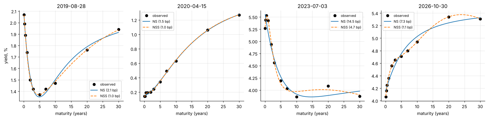
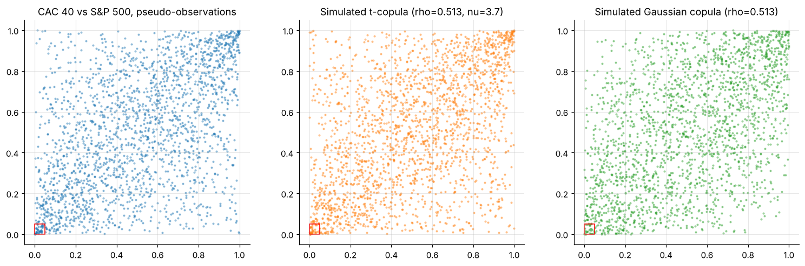

# Financial Econometrics Lab

Applied time-series econometrics on real market data: yield-curve fitting, GARCH-family volatility forecasting, unit roots and cointegration, extreme value theory, copulas, and honest out-of-sample evaluation of return forecasts.

It is built as a small, tested Python package (`fineco`) plus six executed notebooks. Each notebook ends with findings that are checked against its own output.



## What's inside

| # | Notebook | Methods | Key result |
|---|---|---|---|
| 1 | [Data and stylised facts](notebooks/01_data_and_stylized_facts.ipynb) | calendar alignment, moments, Jarque-Bera, ACF of returns and squared returns | Excess kurtosis 7-15 for all assets; CAC 40 / S&P 500 correlation rises from 0.52 to 0.73 in the 2020 crash |
| 2 | [Yield curve](notebooks/02_yield_curve.ipynb) | Nelson-Siegel, Svensson, dynamic Nelson-Siegel (Diebold-Li) | Svensson fits to about 1 bp; DNS factors correlate 0.94-0.97 with level, slope and curvature proxies |
| 3 | [Volatility models](notebooks/03_volatility_models.ipynb) | GARCH, GJR, EGARCH, FIGARCH (Student-t), EWMA; rolling refits; QLIKE loss | Equities show strong leverage effects; for Bitcoin, simple EWMA beats every GARCH out of sample |
| 4 | [Cointegration](notebooks/04_cointegration.ipynb) | ADF, KPSS, Engle-Granger, Johansen, VECM, rolling tests | Testing returns instead of prices gives 100% false positives; the assets are not cointegrated, but Treasury yields are |
| 5 | [Tails and copulas](notebooks/05_tails_and_copulas.ipynb) | Hill estimator, peaks-over-threshold GPD, Gaussian, Student-t, Clayton and Gumbel copulas | Normal ES is 35-40% too low; Gaussian copula predicts 25 joint crashes vs 40 observed (t-copula: 37) |
| 6 | [Forecast evaluation](notebooks/06_forecast_evaluation.ipynb) | walk-forward ARMA and VAR, out-of-sample R², Diebold-Mariano, binomial hit-rate test, cost-aware backtest | No model beats the historical mean; sign strategies lose money after costs |

## Design choices that matter

* **No look-ahead anywhere.** Volatility and return models are re-estimated on rolling windows using only data available at the forecast date, and model orders are selected on training data only. A test (`test_arma_walk_forward_has_no_lookahead`) checks that forecasts depend on yesterday's value, not today's.
* **Cointegration on levels, not returns.** Notebook 4 simulates independent random walks to show why the common shortcut of testing returns is wrong.
* **Calendar alignment without forward-filling.** Bitcoin trades every day and the ETFs do not. Filling gaps would create artificial zero returns, so joint analyses use common trading days only.
* **Robust estimation.** Yield-curve betas are profiled out by least squares so only the decay parameters are optimised (multi-start for Svensson). Copulas are fitted by maximum likelihood on rank-transformed data, so the marginals do not distort dependence.
* **Proper loss functions.** Variance forecasts are ranked by QLIKE, which stays consistent when squared returns stand in for the true variance.



## Package

```
fineco/
  data.py           load and align snapshots, summary statistics
  yieldcurve.py     Nelson-Siegel, Svensson, dynamic NS panel fit
  volatility.py     GARCH family, rolling variance forecasts, QLIKE
  cointegration.py  ADF/KPSS table, Engle-Granger, Johansen, VECM, spurious-test demo
  tails.py          Hill, POT-GPD VaR/ES, four copulas, tail dependence
  forecasting.py    walk-forward ARMA/VAR, Diebold-Mariano, strategy evaluation
tests/              9 tests: parameter recovery on simulated data, no-look-ahead checks
```

```python
from fineco import data, tails
r = data.log_returns(data.load_prices())
tails.var_es_table(r["sp500"], p=0.99)          # Normal vs t vs historical vs EVT
tails.fit_copulas(tails.pseudo_obs(r[["cac40_etf", "sp500"]]))
```

## Data

The `data/` folder holds snapshots, so every notebook runs offline and reproduces the numbers shown:

* `prices.csv`: daily adjusted closes from Yahoo Finance, January 2018 to October 2026, for GLD, C40.PA, BTC-USD and ^GSPC.
* `treasury_yields.csv`: FRED constant-maturity Treasury yields, 1 month to 30 years.

Refresh both with `python scripts/fetch_data.py`.

## Run it

```bash
pip install -r requirements.txt
pytest -q
jupyter lab notebooks/
```

## Background

These analyses grew out of econometrics coursework in the WorldQuant University MSc in Financial Engineering and were developed from a team project. Everything here is an independent, rewritten implementation. Compared with the coursework it uses a longer sample, adds out-of-sample testing and fixes methodological issues: cointegration tests on returns, forward-filled calendars, and strategies selected and scored on the same data.

---
**Author:** Dr. Muhammad Imran Bhatti, PhD (Finance), MScFE · FCMA · [LinkedIn](https://www.linkedin.com/in/drimranbhatti) · [imranbhatti.com](https://imranbhatti.com)

*Research only; not investment advice. MIT licensed.*
